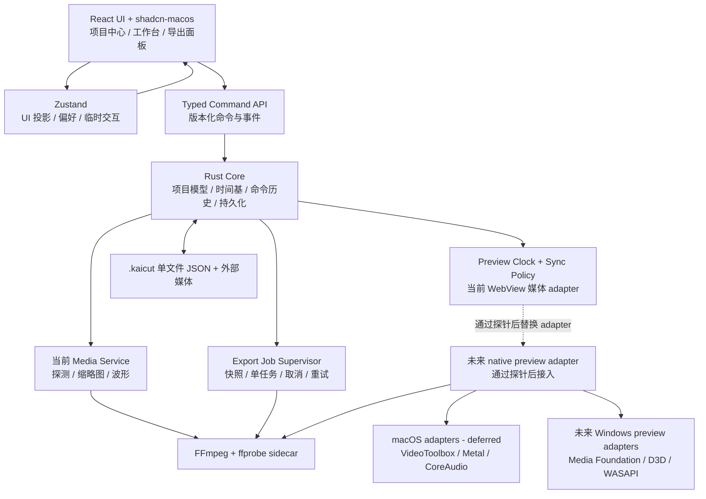

# KaiCut 系统架构规划

- **状态**：持续演进；2026-10-16 已批准渐进媒体内核，首批为 WebView 音频主时钟与长时验证
- **推荐组合**：Tauri 2 + React + TypeScript + Vite + Tailwind CSS + shadcn-macos + Zustand + Rust + FFmpeg sidecar
- **平台策略**：Windows 当前优先交付；macOS 待设备后适配，Linux 延后
- **关联文档**：[PRD.md](./PRD.md)、[DESIGN.md](./DESIGN.md)、[TASKS.md](./TASKS.md)

当前没有 Mac 设备。M0–M5 的当前执行和发布门槛仅针对 Windows；已有 macOS 条件分支与接口作为未来适配基础保留，不表示已支持。

## 第一阶段实施约束（2026-10-06）

用户已确认初始化，当前采用 Tauri 2 + React + TypeScript + Vite + Tailwind CSS v4 + shadcn-macos + Zustand + Rust。按最新要求，KaiCut 自有代码为 Apache-2.0，FFmpeg 为独立 LGPL sidecar（默认 LGPL-2.1-or-later，排除 GPL/nonfree 构建）。`.kaicut` 确定为**单文件 JSON**，取代此前目录包建议；目录包只保留为历史方案，不能按当前实现要求执行。

当前已交付项目/素材管理、离线重新链接、恢复与最近项目、LGPL sidecar 媒体探测、缓存首帧/图片、运行时波形、连续播放与音频跟随，以及基础 2V+2A 编辑命令（添加、分割、删除、副本、移动、裁切、锁轨、批量选择、波纹删除、主轨磁吸、同类型成组拖动与历史）。Rust 持有权威轨道历史和修订号；前端仅投影，拖动预览释放时提交。项目 v2 与旧空轨 v1 迁移、音量/静音/片段淡入淡出持久化已接入。Windows 已接入不可变导出快照、单任务后台 H.264/AAC 编码、进度、取消、同次运行重试、原子无覆盖发布与中断历史恢复；首版限 64 个片段、1080p，音画自动关联、变速/关键帧和完整硬件路径仍待实现。接口以 [CONTRACT.md](../src-tauri/CONTRACT.md) 为准，剪映操作对齐进度见 [EDITING-OPERATIONS.md](./EDITING-OPERATIONS.md)。导出进入 M3 前的证据门槛见 [M3-EXPORT-PREFLIGHT.md](./M3-EXPORT-PREFLIGHT.md)。

## 关键技术决策

### 选型对比

| 方案 | 优点 | 主要成本 / 风险 | 结论 |
| --- | --- | --- | --- |
| **Tauri 2 + React** | 包体和内存占用较低；Rust 适合文件、进程、媒体和平台 API 边界；能接入 VideoToolbox、Metal、CoreAudio、Media Foundation 与 D3D helper | macOS WKWebView 与 Windows WebView2 渲染和媒体能力不同；Rust ↔ JS IPC、sidecar 打包、原生纹理互操作和调试成本较高 | **推荐**，但必须先通过 M0 能力探针 |
| Electron + React | 固定 Chromium 版本带来更一致的 Canvas/WebGL/媒体行为；Node 进程、Worker 和 FFmpeg sidecar 集成快；生态成熟，适合快速验证交互 | 包体、内存和电耗更高；需严格处理 sandbox、contextIsolation、preload 白名单和 IPC 校验；原生 Metal/D3D 仍需 helper 或 addon | 如果首要目标是最短时间交付可用 MVP，或 Tauri 的 WebView/原生纹理探针失败，作为备用方案 |
| Qt 6 + C++/QML | Qt Quick 场景图和窗口/输入/原生媒体整合强；长期做专业时间线、自定义渲染和低层性能更稳 | C++/QML 开发与调试成本最高；与 React/shadcn-macos 规划不一致；Qt 授权、插件和部署合规需要单独管理 | 不用于当前首版；只有在长期转向重型专业 NLE 时重新评估 |

### 推荐理由与切换条件

推荐 Tauri 2，是因为 KaiCut 的最终形态需要本地文件、进程监督、硬件媒体路径和较低常驻资源占用，Rust 能把这些能力集中在受控边界内，同时保留 React 与既定 shadcn-macos 设计系统。

这不是无条件承诺。M0 必须验证：

1. 在 Windows WebView2 中验证预览、精确 seek、时间线 Canvas/DOM 混合渲染和键盘交互；macOS WKWebView 验证待设备到位。
2. FFmpeg sidecar 在 Windows 上可靠启动、读取事件、取消、崩溃恢复，并验证打包与签名。
3. Windows 媒体硬件路径完成可行性验证；保留跨平台边界，暂不投入 macOS 专属实现和性能调优。
4. IPC 不需要逐帧传输大块像素数据。

若关键能力探针失败，或必须维护平台专属的两套渲染器，切换到 Electron + React 以降低首版交付风险。Electron 不是“更专业”的答案，只是在快速 MVP 阶段用较高资源占用换取 Chromium 一致性。

## 分层架构

## UI 层

- React + TypeScript + Vite 负责页面结构、表单、菜单、工作台布局和可访问语义。
- Tailwind CSS 与 `shadcn-macos` 负责基础组件和设计 token；时间线、波形、预览和裁切手柄属于 KaiCut 自有业务组件。
- UI 不直接拼接 shell 命令、不直接读写项目文件、不管理 FFmpeg 子进程。
- UI 的高频拖动只维护临时状态；拖动结束后发送一次 typed command，避免每个 pointer move 都穿过 IPC。

## 时间线引擎

时间线模型由 Rust Core 作为唯一持久化权威，使用命令和修订号更新。React/Zustand 只保存视图投影、选择状态、偏好和临时拖动状态，避免两个可写的真相源。

### 时间基

- 当前持久化编辑坐标使用整数项目帧，以及帧率分子/分母；不按定时器次数累加浮点秒。未来 native 解码可在 adapter 内使用有理时间/PTS，仍通过明确换算进入编辑坐标。
- 当前 `.kaicut v2` 的 timebase 保存帧率分子/分母；媒体采样率等来自运行时 probe。CFR/VFR 标识、drop-frame 显示配置等属于后续扩展，不在本轮添加到 schema。
- 显示层只负责格式化时间码；裁切、吸附、拆分和导出使用同一套 timebase。
- 未来的音画关联功能应支持成组片段操作，并保证拆分、移动和撤销不会遗留音频链接；当前版本仅提供运行时多选和同类型片段批量编辑，不声明音画自动关联。

### 渲染策略

当前使用带视口裁剪的 DOM 时间线与运行时媒体缩略图/波形。下面区分已采用规则和后续渲染目标：

- DOM/ARIA 层表达轨道、片段名称、起止时间、选择、锁定和静音，保证键盘与辅助技术可用。
- Canvas 或 OffscreenCanvas 可承担波形和缩略图等密集内容；只绘制视口附近内容，保持用户已确认的无网格轨道视觉。
- 播放头使用独立层，避免整个时间线随每帧重绘。
- 当前缩略图和波形使用受限运行时结果，缩略图另有应用缓存；多尺度/LOD 缓存属于后续优化目标，不把完整视频帧或大波形数组放入 Zustand。
- 1000+ 片段测试夹具是性能门槛，时间线操作和播放头目标为 60fps；未达标时先降级细节，不牺牲编辑语义。

## 预览管线

目标预览管线分为解复用、解码、合成、呈现和音频时钟五部分。当前播放实际由 WebView2 的 video/audio 元素承载，Rust 负责项目权威状态与受控媒体路径；它尚未成为独立的 Rust 解码/音频输出内核。React 不直接解码 FFmpeg，也不通过 IPC 每帧传递像素。

### 已批准的渐进内核第一批

用户选择保留现有编辑工作台，逐步替换媒体内核。本批仅实现可维护的时钟与同步策略，并用真实 WebView adapter 完成 10 分钟验证；没有 UI 布局、样式、快捷键、项目格式、FFmpeg 二进制或导出语义变化。实施计划见 [preview-clock plan](./superpowers/plans/2026-10-16-preview-clock.md)，预览规则及验收边界见 [PREVIEW-PARITY.md](./PREVIEW-PARITY.md)。

| 职责 | 第一批实现范围 | 必须隐藏在该模块内的复杂度 |
| --- | --- | --- |
| 帧解析 | 现有 `resolveTimelineFrame`，继续选择可见画面与活动音轨 | 半开片段区间、轨道顺序、源入点映射；不因选择状态改变合成 |
| 时钟映射与媒体同步策略 | `src/lib/preview-clock.ts` 纯模块 | 源时间到项目帧换算、同源连续区间判定、有限速度校正或有保护的硬 seek，不直接操作 DOM |
| 项目播放时钟编排 | 现有预览组件中的运行时协调器 | 主时钟选择、缓冲冻结、跨片段换主、空隙单调推进与显式 seek 重锚；复用纯模块规则 |
| WebView adapter | 读写真实 HTMLMediaElement，向策略提供观测并执行结果 | readyState/seeking/paused、play Promise 生命周期、播放速率复位、媒体身份与节点复用 |
| 观测与验收 | 既有 MCP 结构化检查及合成媒体长时脚本 | 主时钟来源、缓冲、偏差、硬 seek 次数、片段身份、真实经过时间；观测数据不进入项目文件 |

当前只有 WebView 一个真实 adapter，不为尚未实现的 Rust/native 后端建立空壳类层级。时钟换算和同步策略先从 React 组件中提取到一个纯模块，公开 `mediaProjectFrame`、`continuousSource`、`syncAdjustment` 三个小接口供测试和真实 adapter 调用；媒体生命周期仍由实际挂载节点处管理。未来的 native adapter 需先证明时钟读回、seek 完成通知、纹理呈现与取消生命周期可用，再替换媒体观测/执行部分，保留编辑命令及项目权威状态。

### MVP fallback

原生媒体第二探针 `native_media_probe` 以独立feature运行，复用真实WASAPI时钟，把已审计FFmpeg解码的PCM送入专属静音session，并以同一设备时间选择实际解码视频帧的PTS。已验证的范围是短素材离线解码、有限PCM队列、暂停/Reset定位/取消；没有D3D呈现、流式解码或主应用播放器替换。原声包与静音时钟包使用不同显式模式，PCM模式不得自动补SILENT包。细节见 [NATIVE-MEDIA-PROBE.md](./NATIVE-MEDIA-PROBE.md)。

P0 已具备在已审查的 LGPL 构建中探测 H.264/AAC 编码器的基础；Windows sidecar 启用了 `h264_mf`，代表性测试已成功生成 H.264/AAC MP4。软件 H.264 解码不能替代编码器能力，不能默认回退到 GPL 的 libx264。没有可用 MFT 时必须明确报告；基础导出任务与 WebView 播放已接入，跨设备验证仍待完成，macOS 播放验证延期。

### 目标平台路径

独立D3D探针已追加实际硬件纹理上传、固定着色器Draw和staging读回：`native_d3d_probe`复用原生媒体驱动，按WASAPI时间选择解码帧，再核对离屏像素。校准图和真实帧读回已在本机Intel Arc验证。它没有swap chain或Present，不是应用原生画面呈现能力；同步读回只用于诊断，未来生产路径需有界解码/渲染队列、统一epoch和实际呈现反馈。见 [NATIVE-D3D-PROBE.md](./NATIVE-D3D-PROBE.md)。

后续独立 `native_queue_probe` 已将该离屏renderer移到专属线程：纯 `PreviewQueue<T, R>` 只管理容量、epoch与计数；worker管理线程、错误、唤醒及join。音频线程通过try_lock提交/消费，不等待GPU；队列最多2项pending、1项in-flight、1项latest completion，满时淘汰最旧pending。暂停、定位、取消立即切换渲染epoch；旧在途任务可以完成计算，但不能发布到新代次。终止性错误独立保存，关闭时先停音频再清队列并join，不将无法中断的驱动调用描述为有硬截止时间。本机普通和120ms慢渲染验证均通过，普通模式实际观察到一次过期GPU完成被拒绝。该队列仍基于短素材预解码，尚非流式解码/实际呈现后端。见 [NATIVE-QUEUE-PROBE.md](./NATIVE-QUEUE-PROBE.md)。

后续 `native_stream_probe` 将解码与会话生命周期分别封装：`stream_process`拥有隐藏子进程、日志和Job Object；`streaming_decoder`将逐行真实PTS与RGB帧配对、流式解析WAV，并限制音频8×480帧、视频4帧的队列；`preview_session`只验证epoch和状态转换，实际IO由driver执行。准备要求音频已经进入endpoint且首画面可用，结束要求解码EOF与设备时钟/缓冲排空同时成立。seek先停止音频并使旧代次失效，回收旧解码进程后重开，按源位置精确丢弃前面的数据；目前没有索引seek或流式硬件解码。输入缓存上限不代表FFmpeg内部/OS pipe/GPU的总内存。此入口不改变主应用预览、项目schema或MCP工具。细节见 [NATIVE-STREAM-PROBE.md](./NATIVE-STREAM-PROBE.md)。

音频调度进一步支持显式`poll/event/event-mmcss`对照。事件模式用共享WASAPI的EVENTCALLBACK与auto-reset事件，按官方要求Initialize时请求0/0并读回实际缓冲；MMCSS通过独立线程守卫仅在播放阶段注册Audio/NORMAL并显式恢复。事件超时或注册/恢复失败均传播，默认诊断入口仍保留poll，不自动改变主应用。GPU关闭诊断拆分工作循环退出、backend析构与join等待；真实对照显示部分关闭延迟主要处于backend析构，不能把总join耗时当GPU渲染时间。单机四轮功能与供给预算验证通过，产品级实时资格仍保持未通过。见 [NATIVE-EVENT-AUDIO-PROBE.md](./NATIVE-EVENT-AUDIO-PROBE.md)。

图形所有权已在诊断管线中提升到`RendererOwner`：每个`Playback`仅借用同一`AsyncRenderer`。取消时停止音频、回收decoder并推进渲染代次；`retire_epoch`确认旧在途任务结束、队列/完成槽清空且worker健康后才允许下一个会话。`--renderer-lifetime shared`保留设备到整个流程最后，`scoped`作为每会话重建的对照。真实两次shared运行均跨两个会话保持同一backend实例，只创建/关闭一次；固定160×90图形资源不因source切换重建。完整20秒源、末帧599及960000音频帧验证通过，但多分辨率资源重建、设备丢失恢复、长时压力及最终退出延迟仍未验收。见 [NATIVE-REUSE-PROBE.md](./NATIVE-REUSE-PROBE.md)。

后续HD探针将输出尺寸参数贯穿解码pipe、帧队列和renderer，以release构建验证真实1920×1080/60秒源。视频队列仍最多4帧，但新增字节上限及高水位，1080p队列容量为24,883,200字节；其它RGB引用、RGBA暂存、D3D纹理、FFmpeg与系统缓存另计。独立参考ledger记录1800帧PTS及RGB/预期RGBA哈希，播放后比对实际消费结果，避免11.2GB整段raw预载。本机功能/供音预算验证通过，但8项pending淘汰与90.4ms渲染完成间隔仍保留，不能将逐帧readback诊断称为可见30fps播放器。见 [NATIVE-HD-PROBE.md](./NATIVE-HD-PROBE.md)。

受控随机定位在`seek_plan`中集中帧锚点、时间基和PCM约束，`streaming_decoder`执行输入seek并过滤ffprobe返回的前置关键帧PTS，再按实际时间戳与RGB配对。音频从整秒输入位置读取，精确丢弃剩余采样；实际读取量与绝对源位置分开计数。为规避已确认的FFprobe7.1开放区间未初始化字段问题，区间必须带显式绝对终点，严格计数和hash验证不放宽。`indexed-cfr`仅显式启用，受控30秒定位总准备由4.74秒降到166ms，完整60秒回归后为145ms；默认顺序模式、主应用后端和项目格式不变。见 [NATIVE-SEEK-PROBE.md](./NATIVE-SEEK-PROBE.md)。

后续兼容性使用独立`timestamp_index`建立有界真实帧PTS表，按前一展示帧选择目标，不再从平均帧率推导索引。`IndexedPts`每次重新扫描并记录成本，扫描前后核对源指纹；真实首帧归一化与绝对输入seek分开。PCM保持精确定位，AAC先完整顺序解码再按样本裁取，避免直接seek产生的解码器状态差异。独立解码矩阵已验证VFR零/非零起点、含B帧视频分别搭配WAV/AAC的完整与局部读取。它尚未连接新的实时呈现或音频时间模型；旧HD设备回归单独保留。见 [NATIVE-COMPAT-PROBE.md](./NATIVE-COMPAT-PROBE.md)。

独立`audio_timeline`将真实首个解码音频PTS与视频PTS的差保留为带符号有理数，计算一个固定输出窗口的静音/源PCM组成，不把packet priming重复扣除。源PCM片段通过已有解码器按精确采样位置读取，窗口外明确补零；每块最多4800帧。新探针以非周期左右不同的音频验证正/负偏移、单采样边界和EOF，纯时间映射与媒体IO保持分离。它是块首查询策略，未来连续供给仍需持有整数采样游标；本轮没有改变实际播放器的连续音频传输。见 [NATIVE-AUDIO-TIMING.md](./NATIVE-AUDIO-TIMING.md)。

`audio_cursor`进一步把一次时间定位转成持续的整数采样位置，通过reserve/commit区分准备量和输出端实际接受量。`audio_transfer`持有单个decoder及有界待提交PCM包，部分写后保留包尾，零写不前进，暂停保留游标，定位推进epoch并清旧数据。正数部分确认换发票据ID，重复确认不能二次消费。独立连续探针已核对6组24段原始输出和一次13秒静音WASAPI真实写入；时间映射、媒体组装和设备输出仍分层，主应用播放路径尚未使用这些模块。见 [NATIVE-AUDIO-TRANSPORT.md](./NATIVE-AUDIO-TRANSPORT.md)。

`audio_preview_adapter`将传输游标与设备控制统一到单线程所有者，依赖窄接口以测试设备写入/清理失败。Ready要求设备已预填且下一包PCM就绪，新包大小受设备容量约束；写入前缀也受首次观察到的可用容量限制，避免设备并行消费导致错误判断。暂停保留排队PCM，定位与取消清空设备缓冲并隔离旧票据。异常停止、重置和decoder关闭均尽力执行且保留证据。独立双轮WASAPI验证覆盖四个位置及排队期间的seek/cancel，尚未连接主应用或GPU呈现。见 [NATIVE-AUDIO-ADAPTER.md](./NATIVE-AUDIO-ADAPTER.md)。

`AudioTransfer::new_av`使音频适配器与视频选择共用一个解码会话及源代次；纯`video_timeline`只保留current/future各一帧，按真实PTS选择已知到期帧，未来帧不提前提交。独立AV协调器以WASAPI设备位置/频率映射项目时间，准备阶段等待准确首帧GPU完成再启动音频，运行中只非阻塞提交/轮询；控制阶段先停音频再退休渲染代次。源代次与渲染代次分别核验，定位清空两者旧数据。新包请求同时受解码器480帧量子限制，减小凑满设备容量包带来的等待；默认音频路径保留。两轮受控VFR/偏移AAC的静音音频与离屏GPU协同通过，正式屏幕呈现和跨设备同步仍未实现。见 [NATIVE-AV-SESSION.md](./NATIVE-AV-SESSION.md)。

呈现边界新增独立`native-present-probe`：同线程D3D11所有者绘制真实DXGI composition背缓冲，再调用`Present(0, DO_NOT_WAIT)`；不创建HWND、不绑定visual，也不启用音频。正常提交与诊断读回拆开，前者无CopyResource/Map/query等待但仍有CPU转换和上传，不能称零拷贝。纯gate管理代次、尺寸切换、零尺寸暂停与终态；非零resize先释放视图和绑定，再ResizeBuffers并重建尺寸资源。两轮硬件调用与选定背缓冲内容核验、旧AV离屏回归均通过。下一步连接音频时钟驱动的帧队列与该提交接口，再单独验收可见surface的尺寸/DPI/遮挡生命周期；S_OK不等于屏幕显示或物理同步。见 [NATIVE-PRESENT-PROBE.md](./NATIVE-PRESENT-PROBE.md)。

`native-av-present-probe`进一步把WASAPI设备时钟、VFR选帧和composition提交连成独立后台流程。呈现worker拥有2项pending、1项在途和1项最新结果，生产者投递与取结果均不等待GPU；只有准备帧执行像素读回，普通帧保留源哈希与实际Present状态。DXGI忙不视为成功，下一生产者tick可重交最新帧，迟到忙结果不得清除更新投递。暂停/定位/取消先停止音频，再失效队列并等在途调用返回；确认退役不代表GPU或合成器已完成。正常与120ms人工延迟场景验证了队列上限、旧任务淘汰和供音间隔，尚无HWND/visual绑定及屏幕输出。当前固定320×180验证，窗口/DPI/尺寸和高分辨率长时呈现仍是后续门槛。见 [NATIVE-AV-PRESENT.md](./NATIVE-AV-PRESENT.md)。

窗口连接层使用纯`SurfaceLifecycle`管理挂载、布局、暂停、卸载与关闭，逻辑尺寸按`ceil(logical × scale)`换算物理尺寸，后端成功确认后才更新已确认状态。平台实现以既有D3D设备创建DirectComposition target/visual，借用同进程HWND；宿主负责保证窗口寿命，先解绑和释放图形引用，再在窗口创建线程销毁。独立`native_surface_probe`使用隐藏且不可激活的普通Win32窗口检验真实绑定与尺寸调用；这条路径没有接入Tauri/WebView层级、真实窗口事件或音频运行时布局变更。后续主应用接入必须明确原生子表面与WebView的裁切、遮挡和输入路由，不能只把一个独立HWND的成功当作播放器集成完成。见 [NATIVE-SURFACE.md](./NATIVE-SURFACE.md)。

`native-preview-host`把子表面接到实际Tauri主窗口，前端测量现有预览内容区，Rust验证会话序号、视口和DPI后在事件线程创建/调整同进程child HWND。单独使用该开发开关时仍只画校准图；正常运行不开设备。浮动控制条保留在WebView，弹层或动画期间隐藏子表面，窗口事件要求重新测量。图形对象由子窗口所有者持有，显式释放和子WM_DESTROY兜底避免借用父窗口失效；MCP可读窗口关系、实际坐标和校准结果。真实AV队列已由后续源素材开发开关接入；本段校准入口仍不覆盖真实用户输入、可见效果或物理同步验收。见 [NATIVE-TAURI-PREVIEW.md](./NATIVE-TAURI-PREVIEW.md)。

实际媒体进一步通过`MediaActor`接入Tauri子表面：单一后台线程拥有解码会话、WASAPI与音频时钟；有界原生队列将Arc帧引用交给事件线程，最多一帧待处理、一项执行中的回调，像素不经过JS IPC。准备阶段核验实际source-fit背缓冲后才启音，运行时只提交源帧与保留原始状态；GPU整数采样保持宽高比并补黑边。暂停/定位/取消独立更新渲染代次，主线程barrier确认已经进入的旧调用结束；遮挡期间画面提交被拒绝而音频继续。窗口尺寸在本批暂停期间更改。用户素材选择、播放/暂停和秒数定位已在显式`--native-source-preview`开发开关下接入；首批只准入单视频流加48kHz双声道AAC的MP4/MOV，最长60秒、最大512MiB、最高1920×1080、方形像素且无旋转。自然EOF、精确片尾定位、重播、旧token隔离和关闭后WebView回退已有两轮隐藏实例证据；多轨、实时尺寸、可见输出和物理同步仍需独立验收。见 [NATIVE-TAURI-MEDIA.md](./NATIVE-TAURI-MEDIA.md) 与 [NATIVE-SOURCE-PREVIEW.md](./NATIVE-SOURCE-PREVIEW.md)。

Windows原生路径已增加独立 `native-clock-probe` Rust example。它通过shared-mode静音流读取真实IAudioClock，以独立于PCM采样率的GetFrequency换算项目时间，验证Stop/Resume/Reset与epoch隔离。该探针不被默认桌面构建启用；目前没有接入解码PCM、视频PTS或D3D呈现，现有WebView播放器仍是实际产品路径。范围与实测证据见 [NATIVE-CLOCK-PROBE.md](./NATIVE-CLOCK-PROBE.md)。

- **macOS（延期，待设备后单独验证）**：VideoToolbox 负责硬件编解码能力，Metal 负责预览合成与纹理呈现，CoreAudio 负责音频输出和时钟。需要单独的 Rust FFI 或 native helper，不能假设 React 可以直接访问这些 API。
- **Windows（当前交付平台）**：当前预览由 WebView2 负责，导出使用 FFmpeg 的 `h264_mf`。未来 native 预览目标为 Media Foundation 解码协商、D3D11/12 纹理/合成、WASAPI 音频输出/时钟；其中D3D11呈现与WASAPI已接入开发开关下的单源预览，当前由LGPL FFmpeg软件解码；Media Foundation硬件解码协商仍待实现。固定20秒和59秒单源跨度压力各自完成两轮隐藏静音验证，未复现自然欠载；59秒样本仍是320×180且在现有60秒准入范围内，详见 [长跨度验证](./NATIVE-SOURCE-LONG-SPAN-STRESS.md)。结果独立于旧自然欠载失败记录，仍不代表可见输出、听感、物理同步或跨设备性能。软件解码降级需单独验证；H.264 编码没有未经审查的替代 fallback。
- **Linux**：延后正式支持；先保留 FFmpeg 软件解码/编码和 WebView 可用的实色预览，不保证硬件加速或所有桌面环境一致。

### 音视频同步：第一批规则与目标

- 主时钟优先来自 `resolved.audio[0]`，即按项目轨道顺序的第一条活动独立音轨；静音轨不参与，淡化端点/音量为零但未静音的活动片段仍保留。其次为可见视频（不要求含嵌入音频），无活动媒体时用单调时钟跨越图片/黑场。这里的“音频主时钟”是 WebView 媒体元素 `currentTime`，不冒充 WASAPI 的声卡播放位置。
- 有效音频时钟通过 `clip.startFrame + sourceSeconds × fps - clip.sourceInFrame` 映射为项目位置；保留浮点观测精度，仅在公开播放头处按项目帧取整。切换片段或主时钟时按项目坐标连续衔接，不能从新素材的 source time 重新从零计算。
- 预期主节点缺失、片段身份未更新、正在定位、waiting、readyState<3 或尚未播放时冻结项目时钟并暂停从节点，不用墙钟越过未解码媒体。完全无媒体的真实空隙才允许单调推进；恢复就绪时重锚，避免把等待时长补成向前跳跃。
- 另设 250ms 无前进 watchdog：即使 readyState 就绪且没有 waiting 事件，主媒体 currentTime 在同一节点/片段内连续 250ms 没有可观察前进，也进入 buffering 并暂停从节点，避免从节点不断前进后被拉回。允许 100ms 量化时钟正常前进；显式 seek、切段/换主或暂停重置观察，主媒体继续前进后恢复，不人为推动主媒体时间。
- 从节点偏差在 20ms 内保持 1x；更大但未超过 250ms 时将 playbackRate 限制在 0.97–1.03 范围内校正。超过 250ms 才考虑运行中的硬 seek，已有 seek 未完成时不重写 currentTime；显式用户 seek/片段源不连续是单独的强制定位，不能被主时钟“不追墙钟”规则吞掉。元数据未就绪导致定位失败时保留请求，等待媒体事件再尝试；不另设未验证的固定冷却时间。
- 同源相邻片段复用稳定媒体节点；身份包含轨道/媒体及来源指纹，仍更新 clip ID 和映射。源入点不连续、媒体变化、暂停、模式/项目/revision 切换必须重锚或停止旧流，晚到的 play Promise 不得复活旧会话。
- 初批门槛：在 30fps 合成夹具上实际连续播放至少 600 秒，分开报告音视频相对媒体时间差、相对项目时钟差、主时钟切换与缓冲/seek。M2 的“一帧”目标不因把项目时钟绑定音频而自动通过；必须独立比较音频和视频的项目坐标。稳定样本 P95、最大值与排除窗口全部保留，不能只报告均值。
- 可见窗口呈现节奏、声卡输出延迟、听感、VFR/长 GOP/HDR 和不同采样率矩阵另行验证。未来 native 视频才负责明确 PTS 队列、丢帧/重复帧策略；本批不能声称 WebView 已暴露这些控制能力。

## 媒体引擎与 FFmpeg sidecar

当前 FFmpeg/ffprobe sidecar 承担探测、缩略图、波形与导出，由 Rust 管理进程，参数使用数组传递，禁止拼接 shell 字符串。代理生成和独立软件预览降级仍是后续目标；当前 WebView 播放没有自动切换到 FFmpeg 帧流的实现。

sidecar 需要具备：

- 固定版本和可复现 LGPL 构建配置，默认 `--disable-gpl --disable-nonfree --disable-version3`，逐项验证外部库；不能仅凭开关或 `-version` 判断许可。匹配源码、补丁、构建记录和 notices 交付规则见 `src-tauri/binaries/README.md`。
- 标准化 stdout/stderr 事件解析和版本化进度事件。
- 显式取消、超时、崩溃、重试和临时文件清理。
- 资源限制和日志脱敏，不能把用户完整路径、媒体内容或令牌写入公开日志。
- 当前已执行 Windows 调试打包；正式代码签名与干净机安装仍是发布门槛，不能把调试包当作签名发布包。macOS 嵌套签名、公证与安装测试延期。

项目文件、媒体路径和 sidecar 输入都视为不可信输入：

- 读取单文件 `.kaicut` 时先做扩展名、大小、schema、版本与引用/数值边界校验；当前 v2 拒绝未知字段和不支持的版本，不保留未知数据后继续写回。仅合法 v1 空轨可按既有契约迁移。
- sidecar 只接收参数数组和受控临时目录，禁止 shell 拼接、任意工作目录和未经授权的文件写入。
- 日志默认脱敏绝对路径、用户名称、令牌和媒体内容；崩溃报告不上传原始媒体。
- 外部修改冲突检测/选择流程属于后续目标；当前界面“保存”会以同目录临时文件原子替换既定项目路径，不应声称已有外部版本冲突保护。MCP 另存只允许新路径，禁止覆盖已有目标。

## 状态管理

### Rust Core 的权威状态

- 项目文档、命令历史、撤销/重做、修订号和保存状态。
- 项目中的外部媒体引用与原始文件大小/修改时间。链接检查、ffprobe、缩略图/波形由 Rust 执行并返回运行时结果；这些不属于持久化项目文档。独立代理索引尚未实现。
- 导出任务、取消状态和失败原因；开发开关下的原生源预览会话已由Rust管理；默认WebView播放时钟与媒体节点生命周期仍是运行时adapter状态。

### Zustand 的职责

- 当前页面、面板布局、选择投影、临时拖动、播放头/模式显示、偏好和无障碍开关；高频媒体时钟观测及同步决策局部保存，不把完整采样日志写入 store。
- 接收 Rust 的带修订号会话结果/事件并生成 UI 投影；保存运行时链接、probe、缩略图和波形结果的受限投影。
- 不存储完整视频帧、长波形、sidecar 进程句柄或唯一项目副本。

命令使用类型化参数，编辑请求携带 projectId/revision；MCP UI 请求另有 requestId 与明确确认。导出状态可按 jobId 查询/轮询，取消通过显式 command 完成。不要求当前每一个 Tauri 命令都存在额外自定义协议版本或请求 ID 字段。

## 项目文件格式

当前 `.kaicut` 是 UTF-8 单文件 JSON，schemaVersion 2、最大 10 MiB；不是目录包，不包含内部 `project.json`。合法 v1 空轨项目/恢复点读入时迁移，显式保存才写 v2。当前结构以 [CONTRACT.md](../src-tauri/CONTRACT.md) 和 Rust/TypeScript schema 为准：

| 内容 | 当前写入 `.kaicut` 的字段/位置 | 不在项目文件中的数据 |
| --- | --- | --- |
| 项目 | schemaVersion、appVersion、projectId、name、createdAt、updatedAt、timebase、mediaRefs、tracks | 未定义的 sequence、markers、settings 字段不会自动接受；未知字段拒绝 |
| 时间线 | 每条 track 的 id/name/kind/locked/muted/volume/clips；clip 的 id/mediaId/trackId/startFrame/durationFrames/sourceInFrame/sourceDurationFrames/fadeInFrames/fadeOutFrames | 播放头、选择、多选、预览模式、撤销/重做历史和运行时主时钟 |
| 媒体引用 | id/name/kind/extension/size/lastModified，可选 sourcePath；当前桌面导入使用原文件路径 | 媒体二进制、object/asset URL、probe 元数据、链接状态、缩略图、波形、代理缓存或 hash 字段 |

片段帧字段采用项目 timebase。引用中的 size/lastModified 用于识别源媒体变化；SHA-256 可用于应用缩略图缓存键或独立验收报告，不等于新增项目字段。路径移动后通过既有重新链接流程处理；项目相对路径打包和携带媒体是后续可评估方案，不是本轮格式。

界面“保存”采用同目录临时文件、flush/sync 后原子替换当前项目文件；失败保留旧文件和会话，成功不承诺自动保留上一份 manifest。MCP `project_save_as` 采用 `persist_noclobber` 另存到新路径，任何已有目标都拒绝。独立恢复快照保存在 app-local data，显式保存/丢弃后按契约清理；它不是随 `.kaicut` 携带的 autosave/journal 目录。

导出在 app-local `export-jobs/<jobId>/` 保存不可变 `snapshot.json` 和任务记录；后续编辑不改变该次输入。目标 MP4 经校验后无覆盖发布，已有目标一律拒绝，包括旧请求中的 `overwrite:true`，当前没有“确认后覆盖”通道。失败/取消的任务临时文件按监督器记录清理；若文件占用导致清理失败，记录仍保留并显式报告。

缩略图磁盘缓存位于应用 cache 的 `thumbnails/`，按现有 128 MiB/512 文件预算清理；波形是运行时结果，不写入 `.kaicut`。缓存的用户可见占用面板、清理入口和最低剩余空间阈值是后续体验目标。缓存删除、重建或损坏不能改变项目模型；重新解码失败仍应明确报错。

## 平台支持策略

| 平台 | 首发策略 | 媒体技术 | 支持承诺 |
| --- | --- | --- | --- |
| macOS | 待获得设备后再适配 | VideoToolbox + Metal + CoreAudio；FFmpeg fallback 作为后续方案 | 暂不承诺正式支持；构建、签名、公证、VoiceOver 和架构兼容单独验收 |
| Windows | 当前唯一开发与首发验收平台 | Media Foundation + D3D11/12 + WASAPI；LGPL FFmpeg 按能力降级 | 当前目标：验证 WebView2、缩放、高对比度、NVDA、打包和代码签名，不把规划目标写成已实现 |
| Linux | 延后到 P2 或独立评估 | FFmpeg software fallback；WebKitGTK/系统音频按发行版适配 | 仅实验性，不在首发稳定性承诺内 |

## 尚未锁定的决策与退出条件

| 决策 | 当前初值 | 进入实现前的退出条件 |
| --- | --- | --- |
| P0 轨道上限 | 2V + 2A | 时间线夹具、撤销历史和导出快照验证通过 |
| 默认输出 | 1080p H.264/AAC MP4 | Windows 代表性素材导出并通过同步检查 |
| 项目文件 | `.kaicut` 单文件 JSON，已确定 | 首阶段校验/原子保存；迁移、外部修改冲突、自动恢复后续验证 |
| 预览路径 | 默认WebView adapter；原生单源控件仅在显式开发开关下启用 | 基础控件、准备取消、过期帧拦截与清理保护已验证；有界音频欠载诊断经3次正常运行及2次延迟对照验证，旧偶发欠载未复现/未定位；真实驱动故障、更广准入、可见输出与物理同步仍须独立验证 |
| 硬件加速 | capability matrix，不能用时软件降级 | 当前 Media Foundation/D3D/WASAPI 有可复现结果；macOS 路径延期 |
| 宿主框架 | Tauri 2 | 任一关键 WebView 或 sidecar 门槛失败，重新评估 Electron |

## 权威参考

以下链接用于发布前复核具体版本、API 和许可证，不替代法律或平台审核：

- [Tauri Architecture](https://v2.tauri.app/concept/architecture/)
- [Electron Security](https://www.electronjs.org/docs/latest/tutorial/security)
- [FFmpeg Legal Considerations](https://ffmpeg.org/legal.html)
- [Apple VideoToolbox](https://developer.apple.com/documentation/videotoolbox)
- [Apple Metal](https://developer.apple.com/metal/)
- [Apple Core Audio](https://developer.apple.com/documentation/coreaudio)
- [Microsoft Media Foundation](https://learn.microsoft.com/en-us/windows/win32/medfound/)
- [Microsoft Direct3D](https://learn.microsoft.com/windows/win32/direct3d)
- [Qt Licensing](https://doc.qt.io/qt-6/licensing.html)
