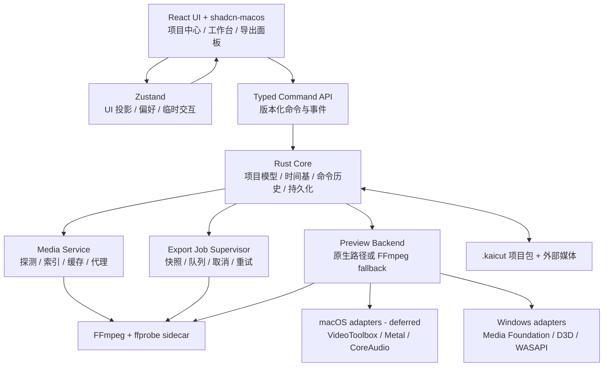

# KaiCut 系统架构规划

- **状态**：规划稿 v0.1
- **推荐组合**：Tauri 2 + React + TypeScript + Vite + Tailwind CSS + shadcn-macos + Zustand + Rust + FFmpeg sidecar
- **平台策略**：Windows 当前优先交付；macOS 待设备后适配，Linux 延后
- **关联文档**：[PRD.md](./PRD.md)、[DESIGN.md](./DESIGN.md)、[TASKS.md](./TASKS.md)

当前没有 Mac 设备。M0–M5 的当前执行和发布门槛仅针对 Windows；已有 macOS 条件分支与接口作为未来适配基础保留，不表示已支持。

## 第一阶段实施约束（2026-10-06）

用户已确认初始化，当前采用 Tauri 2 + React + TypeScript + Vite + Tailwind CSS v4 + shadcn-macos + Zustand + Rust。按最新要求，KaiCut 自有代码为 Apache-2.0，FFmpeg 为独立 LGPL sidecar（默认 LGPL-2.1-or-later，排除 GPL/nonfree 构建）。`.kaicut` 确定为**单文件 JSON**，取代此前目录包建议；目录包只保留为历史方案，不能按当前实现要求执行。

本阶段交付五区空壳、原生新建/打开/保存、媒体文件元数据和路径引用、2V+2A 空轨道、预览与导出占位、主题与偏好。自动保存、真实预览、剪辑、迁移、导出、平台硬件加速均未进入本次实现。FFmpeg 只有 sidecar 状态与可选打包接口，默认不附二进制。运行接口以 [CONTRACT.md](../src-tauri/CONTRACT.md) 为准，下文媒体架构与里程碑仍是后续目标。

## 关键技术决策

### 选型对比

| 方案 | 优点 | 主要成本 / 风险 | 结论 |
| --- | --- | --- | --- |
| **Tauri 2 + React** | 包体和内存占用较低；Rust 适合文件、进程、媒体和平台 API 边界；能接入 VideoToolbox、Metal、CoreAudio、Media Foundation 与 D3D helper | macOS WKWebView 与 Windows WebView2 渲染和媒体能力不同；Rust ↔ JS IPC、sidecar 打包、原生纹理互操作和调试成本较高 | **推荐**，但必须先通过 M0 能力探针 |
| Electron + React | 固定 Chromium 版本带来更一致的 Canvas/WebGL/媒体行为；Node 进程、Worker 和 FFmpeg sidecar 集成快；生态成熟，适合快速验证交互 | 包体、内存和电耗更高；需严格处理 sandbox、contextIsolation、preload 白名单和 IPC 校验；原生 Metal/D3D 仍需 helper 或 addon | 如果首要目标是最短时间交付可用 MVP，或 Tauri 的 WebView/原生纹理探针失败，作为备用方案 |
| Qt 6 + C++/QML | Qt Quick 场景图和窗口/输入/原生媒体整合强；长期做专业时间线、自定义渲染和低层性能更稳 | C++/QML 开发与调试成本最高；与 React/shadcn-macos 规划不一致；Qt 授权、插件和部署合规需要单独管理 | 不用于当前首版；只有在长期转向重型专业 NLE 时重新评估 |

### 推荐理由与切换条件

推荐 Tauri 2，是因为 KaiCut 的最终形态需要本地文件、进程监督、硬件媒体路径和较低常驻资源占用，Rust 能把这些能力集中在受控边界内，同时保留 React 与既定 shadcn-macos 设计系统。

这不是无条件承诺。M0 必须验证：

1. 在 Windows WebView2 中验证预览、精确 seek、时间线 Canvas/DOM 混合渲染和键盘交互；macOS WKWebView 验证待设备到位。
2. FFmpeg sidecar 在 Windows 上可靠启动、读取事件、取消、崩溃恢复，并验证打包与签名。
3. Windows 媒体硬件路径完成可行性验证；保留跨平台边界，暂不投入 macOS 专属实现和性能调优。
4. IPC 不需要逐帧传输大块像素数据。

若关键能力探针失败，或必须维护平台专属的两套渲染器，切换到 Electron + React 以降低首版交付风险。Electron 不是“更专业”的答案，只是在快速 MVP 阶段用较高资源占用换取 Chromium 一致性。

## 分层架构



## UI 层

- React + TypeScript + Vite 负责页面结构、表单、菜单、工作台布局和可访问语义。
- Tailwind CSS 与 `shadcn-macos` 负责基础组件和设计 token；时间线、波形、预览和裁切手柄属于 KaiCut 自有业务组件。
- UI 不直接拼接 shell 命令、不直接读写项目文件、不管理 FFmpeg 子进程。
- UI 的高频拖动只维护临时状态；拖动结束后发送一次 typed command，避免每个 pointer move 都穿过 IPC。

## 时间线引擎

时间线模型由 Rust Core 作为唯一持久化权威，使用命令和修订号更新。React/Zustand 只保存视图投影、选择状态、偏好和临时拖动状态，避免两个可写的真相源。

### 时间基

- 内部时间使用整数 PTS 或有理数 `Time { value, timescale }`，不使用 JS 浮点数累加。
- 项目保存帧率分子/分母、CFR/VFR 标识、音频采样率、时间码显示模式和 drop-frame/non-drop 选择。
- 显示层只负责格式化时间码；裁切、吸附、拆分和导出使用同一套 timebase。
- 音视频默认以成组片段操作；拆分、移动和撤销不能只更新视频而遗留音频链接。

### 渲染策略

采用混合渲染：

- DOM/ARIA 层表达轨道、片段名称、起止时间、选择、锁定和静音，保证键盘与辅助技术可用。
- Canvas 或 OffscreenCanvas 绘制高密度网格、波形和缩略图；只绘制视口附近内容。
- 播放头使用独立层，避免整个时间线随每帧重绘。
- 波形和缩略图使用多尺度缓存；不可把完整媒体帧或大波形数组放入 Zustand。
- 1000+ 片段测试夹具是性能门槛，时间线操作和播放头目标为 60fps；未达标时先降级细节，不牺牲编辑语义。

## 预览管线

预览分为解复用、解码、合成、呈现和音频时钟五部分。React 不直接解码 FFmpeg，也不通过 IPC 每帧传递像素。

### MVP fallback

P0 可以在已审查的 LGPL 构建中探测 H.264/AAC 编码器，成功后生成低分辨率代理并验证 WebView `<video>` 播放。软件 H.264 解码不能替代编码器能力，不能默认回退到 GPL 的 libx264。没有可用编码器时明确报告；其他代理格式当前需验证 Windows 播放并由产品决定；macOS 播放验证延期，不能静默改变。该路径是后续目标，不代表当前已实现。

### 目标平台路径

- **macOS（延期，待设备后单独验证）**：VideoToolbox 负责硬件编解码能力，Metal 负责预览合成与纹理呈现，CoreAudio 负责音频输出和时钟。需要单独的 Rust FFI 或 native helper，不能假设 React 可以直接访问这些 API。
- **Windows（当前交付平台）**：Media Foundation 负责媒体管线和硬件编解码协商，D3D11/12 负责纹理和合成，WASAPI 负责音频输出与时钟。驱动或格式不可用时回退到 FFmpeg/软件路径。
- **Linux**：延后正式支持；先保留 FFmpeg 软件解码/编码和 WebView 可用的实色预览，不保证硬件加速或所有桌面环境一致。

### 音视频同步

- 播放以音频时钟为主时钟；没有音频时使用单调时钟。
- 视频按照 PTS 对齐，晚到帧丢弃，必要时重复最近帧；seek 时先清空解码队列再从目标时间重新建立状态。
- 处理 VFR、不同采样率、重采样、丢帧和长时间漂移。
- 验收目标：10 分钟素材漂移小于 1 帧；定位误差不超过 1 帧或 1ms。

## 媒体引擎与 FFmpeg sidecar

FFmpeg sidecar 统一承担探测、缩略图、波形、代理生成、软件回退和导出。由 Rust 进程监督器启动，参数使用数组传递，禁止拼接 shell 字符串。

sidecar 需要具备：

- 固定版本和可复现 LGPL 构建配置，默认 `--disable-gpl --disable-nonfree --disable-version3`，逐项验证外部库；不能仅凭开关或 `-version` 判断许可。匹配源码、补丁、构建记录和 notices 交付规则见 `src-tauri/binaries/README.md`。
- 标准化 stdout/stderr 事件解析和版本化进度事件。
- 显式取消、超时、崩溃、重试和临时文件清理。
- 资源限制和日志脱敏，不能把用户完整路径、媒体内容或令牌写入公开日志。
- 当前执行 Windows 打包、签名与干净机验证；macOS 嵌套签名、公证与安装测试延期。

项目文件、媒体路径和 sidecar 输入都视为不可信输入：

- 读取 `project.json` 前先做 schema、路径、大小和版本校验；未知字段可保留但不能执行未知命令。
- sidecar 只接收参数数组和受控临时目录，禁止 shell 拼接、任意工作目录和未经授权的文件写入。
- 日志默认脱敏绝对路径、用户名称、令牌和媒体内容；崩溃报告不上传原始媒体。
- 同一项目被外部修改时显示冲突，允许重新加载、另存为或保留当前编辑；不能静默覆盖外部版本。

## 状态管理

### Rust Core 的权威状态

- 项目文档、命令历史、撤销/重做、修订号和保存状态。
- 媒体索引、离线状态、代理状态和缓存元数据。
- 预览会话、导出任务、取消状态和失败原因。

### Zustand 的职责

- 当前页面、面板布局、选择投影、临时拖动、播放控制显示、偏好和无障碍开关。
- 接收 Rust 的带修订号事件并生成 UI 投影。
- 不存储完整视频帧、长波形、sidecar 进程句柄或唯一项目副本。

所有命令和事件都使用 typed schema、协议版本和请求 ID。长任务通过事件流报告，取消通过显式 command 完成。

## 项目文件格式

当前 `.kaicut` 是 UTF-8 单文件 JSON，schemaVersion 1。大型媒体保持外部引用，缓存与任务文件未来放应用缓存目录；不默认计划迁移为目录包。以下是已被替代的历史目录包示意，仅用于理解旧方案：

```text
Example.kaicut/
├── project.json        # 唯一权威清单，schemaVersion 必须存在
├── autosave/           # 最近有效自动保存与恢复点
├── journal/            # 可选命令日志，用于诊断和恢复
├── cache/              # 缩略图、波形、代理索引；可删除、不可作为权威数据
└── export-jobs/        # 导出快照、临时文件和结果状态
```

`project.json` 至少包含 `schemaVersion`、`appVersion`、`projectId`、项目 timebase、sequence、tracks、clips、markers、mediaRefs、settings 和修改时间。原始媒体默认外置引用，不复制进项目包。

媒体引用保存：项目相对路径（可用时）、绝对路径、文件体积、修改时间、部分或完整 hash、媒体元数据和链接状态。路径移动后先提示重新链接，不静默替换同名文件。

保存采用临时文件写入、刷新、原子替换并保留上一份 manifest；schema 变更必须有迁移版本。导出创建不可变 `snapshot.json` 和独立 job 目录，后续编辑不影响该次任务。缓存删除、重建或损坏不能破坏项目可打开性。

默认缓存目录应有可见的磁盘占用、清理入口和最低剩余空间阈值。导出目标已存在时，默认不直接覆盖；用户明确确认后才替换，并通过临时文件写入后原子改名，避免产生半成品。

## 平台支持策略

| 平台 | 首发策略 | 媒体技术 | 支持承诺 |
| --- | --- | --- | --- |
| macOS | 待获得设备后再适配 | VideoToolbox + Metal + CoreAudio；FFmpeg fallback 作为后续方案 | 暂不承诺正式支持；构建、签名、公证、VoiceOver 和架构兼容单独验收 |
| Windows | 当前唯一开发与首发验收平台 | Media Foundation + D3D11/12 + WASAPI；LGPL FFmpeg 按能力降级 | 当前目标：验证 WebView2、缩放、高对比度、NVDA、打包和代码签名，不把规划目标写成已实现 |
| Linux | 延后到 P2 或独立评估 | FFmpeg software fallback；WebKitGTK/系统音频按发行版适配 | 仅实验性，不在首发稳定性承诺内 |

## 尚未锁定的决策与退出条件

| 决策 | 当前初值 | 进入实现前的退出条件 |
| --- | --- | --- |
| P0 轨道上限 | 2V + 2A | 时间线夹具、撤销历史和导出快照验证通过 |
| 默认输出 | 1080p H.264/AAC MP4 | Windows 代表性素材导出并通过同步检查 |
| 项目文件 | `.kaicut` 单文件 JSON，已确定 | 首阶段校验/原子保存；迁移、外部修改冲突、自动恢复后续验证 |
| 预览路径 | P0 FFmpeg/`<video>` fallback，原生路径渐进启用 | 当前 Windows WebView2 首帧、seek、播放和 GPU 互操作探针通过 |
| 硬件加速 | capability matrix，不能用时软件降级 | 当前 Media Foundation/D3D/WASAPI 有可复现结果；macOS 路径延期 |
| 宿主框架 | Tauri 2 | 任一关键 WebView 或 sidecar 门槛失败，重新评估 Electron |

## 权威参考

以下链接用于发布前复核具体版本、API 和许可证，不替代法律或平台审核：

- [Tauri Architecture](https://v2.tauri.app/concept/architecture/)
- [Electron Security](https://www.electronjs.org/docs/latest/tutorial/security)
- [FFmpeg Legal Considerations](https://ffmpeg.org/legal.html)
- [Apple VideoToolbox](https://developer.apple.com/documentation/videotoolbox)
- [Apple Metal](https://developer.apple.com/metal/)
- [Apple Core Audio](https://developer.apple.com/documentation/coreaudio)
- [Microsoft Media Foundation](https://learn.microsoft.com/en-us/windows/win32/medfound/)
- [Microsoft Direct3D](https://learn.microsoft.com/windows/win32/direct3d)
- [Qt Licensing](https://doc.qt.io/qt-6/licensing.html)
